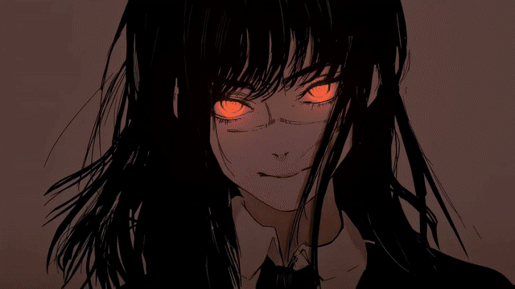
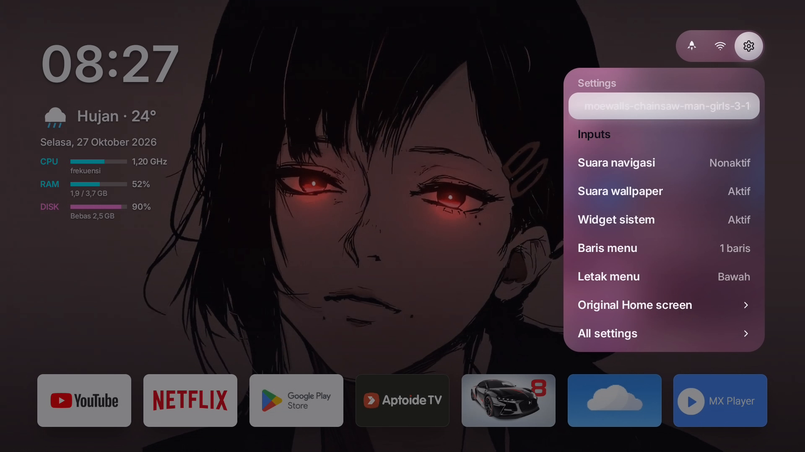

# RZ Launcher 1.0

Launcher Android TV/STB dengan live wallpaper JPG/PNG/MP4, jam dan cuaca, widget CPU/RAM/storage, dan tombol Boost.

## ✨ Fitur

- 🖼️🎬 **Live wallpaper** — gambar JPG/PNG dan video MP4 dari penyimpanan internal
- ⏰🌤️ **Jam dan cuaca** — jam, tanggal lengkap, dan cuaca live
- 📊 **Widget sistem** — CPU (frekuensi), RAM, dan storage
- 🚀 **Boost** — bebaskan memori (perlu root untuk hasil nyata di Android 11)
- ⚙️ **Panel Pengaturan** — wallpaper, suara, widget, baris dan letak menu, launcher bawaan
- 🏠 **Home default** — tekan Home langsung ke RZ Launcher, tanpa dialog berulang

### 📸 Tampilan


*Live wallpaper berjalan — GIF 5 detik, 640x360, dari video wallpaper yang sama dengan tangkapan layar Home sebelumnya.*



*Panel Pengaturan: wallpaper, input, suara, widget, dan pengaturan menu.*

Catatan gambar: tangkapan layar dari tampilan 1.2.20, tata letaknya sama dengan 1.0 kecuali baris About dan Support Developer yang baru. Video wallpaper di gambar adalah aset pihak ketiga, bukan bagian dari repo ini.

## Cara Penggunaan

### Pasang
Pasang APK RZ Launcher 1.0 lewat file manager di TV, izinkan "instal dari sumber tidak dikenal" sekali saja. Tekan Home, pilih RZ Launcher, pilih Selalu. Diuji di Android TV 11, MyRepublic DV8910. Ini launcher TV, bukan untuk HP.

### Supaya wallpaper terbaca saat awal instal (penting)
Android 11 tidak otomatis memberi izin baca penyimpanan ke aplikasi yang baru dipasang. Tanpa izin itu, pemilih wallpaper tampil kosong.

Cara dari TV (tanpa ADB):
Pengaturan TV > Aplikasi > Lihat semua aplikasi > RZ Launcher > Izin > File dan media > Izinkan.

Cara ADB (paling pasti):
```
adb shell pm grant id.rzmong.launcher android.permission.READ_EXTERNAL_STORAGE
```

Setelah izin diberikan, buka Pengaturan RZ Launcher > Wallpaper > pilih folder > pilih file.

Format dan folder wallpaper:
- JPG, PNG, atau MP4. Untuk video, pakai 1920x1080 H.264 60 fps. 4K60 tidak lancar di DV8910.
- Letakkan file di folder sendiri, misalnya `/sdcard/Anime` atau `/sdcard/Agame`.
- Pilih "Chainsaw Man (bawaan)" untuk kembali ke wallpaper bawaan.
- Kalau pemilih wallpaper kosong, cek izin penyimpanan dulu — jangan anggap file hilang.

### Jadikan RZ Launcher default dan nonaktifkan launcher bawaan
Jadikan default: tekan Home > pilih RZ Launcher > Selalu. Kalau dialog pilih launcher muncul lagi, berarti launcher bawaan masih aktif.

Nonaktifkan launcher bawaan — cara mudah (perlu root Magisk):
Pengaturan RZ Launcher > Launcher bawaan > Nonaktif. Pertama kali, ketuk Izinkan saat prompt Magisk muncul.

Nonaktifkan launcher bawaan — cara ADB root:
```
su -c "pm disable com.google.android.tvlauncher"
```

Penting, ini bukan uninstall: paket launcher bawaan tetap terpasang, hanya dinonaktifkan, jadi bisa dikembalikan kapan saja.

Cara mengembalikan launcher bawaan:
- Pengaturan RZ Launcher > Launcher bawaan > Aktif, lalu tekan Home > pilih Beranda Android TV > Selalu.
- Atau lewat ADB root: `su -c "pm enable com.google.android.tvlauncher"`
- Atau dari TV: Pengaturan > Aplikasi > Lihat semua aplikasi > Tampilkan aplikasi sistem > Beranda Android TV > Aktifkan.
- Setelah launcher bawaan aktif lagi, dialog Home akan kembali karena ada 2 launcher. Itu normal, bukan kerusakan.

### Hal lain yang perlu
- Fitur: live wallpaper gambar dan video, jam + cuaca, widget CPU / RAM / storage, Boost.
- Boost root: pertama kali pakai, ketuk Izinkan di prompt Magisk. Tanpa root, Boost di Android 11 hampir tidak membebaskan memori, itu batasan sistem, bukan bug.
- Suara wallpaper: berhenti saat membuka aplikasi lain, jalan lagi saat kembali ke Home.
- Support Developer (versi Public saja): popup muncul saat pertama dibuka, centang "Jangan tampilkan lagi" supaya tidak muncul lagi. Baris Pengaturan "☕ Support Developer" diklik langsung membuka saweria.co/rzmong. Versi Private tidak ada donasi.
- About: Pengaturan > About. Barisnya hanya bertuliskan "About", penjelasan lengkap (profil RZMONG, GitHub, website) baru muncul kalau diklik.
- Troubleshooting singkat: Home tidak ke RZ = cek default dan launcher bawaan; wallpaper tidak jalan = cek format 1080p60; Boost tidak membebaskan = cek izin Magisk; pemilih wallpaper kosong = cek izin penyimpanan.

## 🙏 Credits

- 🎬 **Wallpaper** — video live wallpaper yang tampil di GIF dan tangkapan layar di atas berasal dari website Moewalls (https://moewalls.com), yaitu video "Chainsaw Man Girls 3". Video tersebut adalah aset pihak ketiga, bukan milik RZMONG, dan file video lengkapnya tidak termasuk di repo ini. GIF di atas hanya cuplikan pendek untuk demo.
- 🌸 **Wallpaper bawaan** — sekarang memakai video live yang sedang dipakai (Chainsaw Man Girls 3 dari Moewalls, cuplikan 15 detik 1080p60), bukan lagi gambar bawaan lama.
- 🔗 **Sumber wallpaper:** Moewalls (https://moewalls.com)
- 👤 **Pengembang** — RZMONG (https://github.com/rz7mong, https://www.rzmong.my.id)
- 📄 **Lisensi** — file LICENSE di repo ini memuat pemberitahuan hak cipta dan izin asli.
